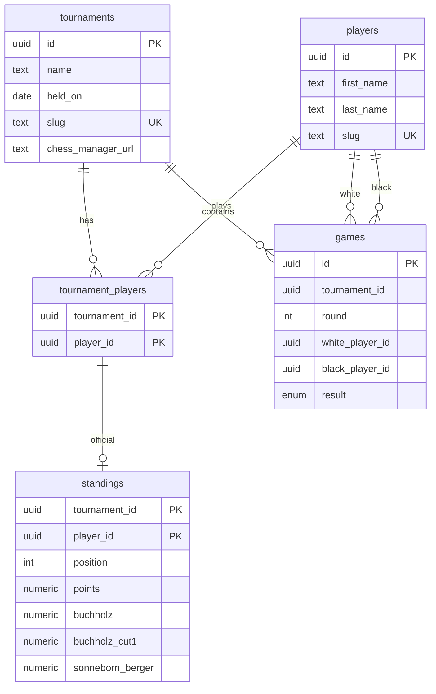

# Database schema

This document is for implementers (including AI agents). It records the **locked Postgres schema** for club facts. Product intent is in [app-overview.md](./app-overview.md). Stack (Neon, Drizzle, on-request stats) is in [tech-stack.md](./tech-stack.md).

When the Next.js app is scaffolded, Drizzle `pgTable` / `pgEnum` and the first migration must follow this document. Do not invent a second schema.

## Stats: compute on request, do not store

**Source of truth is raw rows.** Pages load them and run pure functions in `src/lib/stats/`.

Do **not** add `player_stats` (or any other derived career table), Redis, or upload-time aggregation in v1. New stats are a new function, not a backfill. Time range is first-class: filter `tournaments.held_on`, then aggregate those games/standings. Precomputed “all-time” tables fight that.

If it ever gets slow, cache the same functions (`unstable_cache` / ISR). UI must not depend on cache existing. Still no second source of truth.

Two kinds of numbers:

| Kind | Where it lives |
| --- | --- |
| Official tournament place, points, tie-breaks | **Uploaded** into `standings`. Display as stored. Do not recompute Buchholz from games. |
| Club-wide / player / head-to-head stats | **Derived** from `games` (and sometimes `standings`) in request code. |

Played-game filters for win% belong in stats functions (e.g. result in `white_win`, `black_win`, `draw`, plus optional forfeits) — not in extra tables.

## What this schema is not

Do not add columns or tables for:

- move lists / PGN / clocks / openings
- ratings (FIDE/Elo)
- comments, photos, bios
- `deleted_at` (edit/delete after upload is still undecided)

**Player identity matching** lives in the upload layer (see [app-overview.md](./app-overview.md) / [tech-stack.md](./tech-stack.md)), not in this schema. Names are not unique here; the upload API attaches a TRF name to a `player_id`. The schema assumes stable `player_id`s once resolved.

## Enum: `game_result`

```text
white_win | black_win | draw | white_win_forfeit | black_win_forfeit | unplayed | bye
```

One `games` row per pairing, including byes and unplayed pairings. Distinct codes so stats can include or skip extras later.

- **Bye:** exactly one of `white_player_id` / `black_player_id` is null. The non-null player received the bye.
- **Forfeit / unplayed / played game:** both players set. `white_win_forfeit` means White won because Black forfeited.

## Tables



Slug check (players and tournaments): kebab-case `^[a-z0-9]+(?:-[a-z0-9]+)*$`.

Delete behavior: deleting a tournament cascades to `tournament_players`, `standings`, and `games`. Deleting a player is `RESTRICT` while they appear in any roster.

### `players`

| Column | Type | Notes |
| --- | --- | --- |
| `id` | uuid PK | default `gen_random_uuid()` |
| `first_name` | text not null | not unique |
| `last_name` | text not null | not unique |
| `slug` | text not null unique | kebab-case check; public URL key |
| `full_name` | text generated | `first_name || ' ' || last_name`, stored, for `ILIKE` search |
| `created_at` | timestamptz not null | default `now()` |

`ILIKE` on `full_name` / first / last is enough at this scale. Do not add `pg_trgm` until needed.

### `tournaments`

| Column | Type | Notes |
| --- | --- | --- |
| `id` | uuid PK | default `gen_random_uuid()` |
| `name` | text not null | |
| `held_on` | date not null | single calendar date; time range = this date in range |
| `slug` | text not null unique | kebab-case check; public URL key |
| `chess_manager_url` | text null | optional https URL on `chessmanager.com` or `www.chessmanager.com`; public pages do not show it yet |
| `created_at` | timestamptz not null | default `now()` (upload time) |

A weekend event still uses the start day.

### `tournament_players`

Roster. FK target so a game cannot name a player who is not in that event.

| Column | Type | Notes |
| --- | --- | --- |
| `tournament_id` | uuid PK, FK → `tournaments` | `ON DELETE CASCADE` |
| `player_id` | uuid PK, FK → `players` | `ON DELETE RESTRICT` |

### `standings`

Official table as published. One row per roster entry (1:1 with `tournament_players`).

| Column | Type | Notes |
| --- | --- | --- |
| `tournament_id` | uuid | part of PK |
| `player_id` | uuid | part of PK |
| `position` | integer not null | official place; unique per tournament |
| `points` | numeric(5,1) not null | allows 4.5 |
| `buchholz` | numeric(6,1) null | |
| `buchholz_cut1` | numeric(6,1) null | Buchholz−1 |
| `sonneborn_berger` | numeric(6,1) null | |

- PK `(tournament_id, player_id)`
- FK `(tournament_id, player_id)` → `tournament_players`
- `UNIQUE (tournament_id, position)`

### `games`

| Column | Type | Notes |
| --- | --- | --- |
| `id` | uuid PK | default `gen_random_uuid()` |
| `tournament_id` | uuid not null | FK → `tournaments` `ON DELETE CASCADE` |
| `round` | integer not null | check `> 0` |
| `white_player_id` | uuid null | FK → `players`; null only for a bye given to Black |
| `black_player_id` | uuid null | FK → `players`; null only for a bye given to White |
| `result` | `game_result` not null | see enum above |

Also:

- Composite FKs to `tournament_players` on `(tournament_id, white_player_id)` and `(tournament_id, black_player_id)`. Postgres skips the FK when that player column is null (byes).
- Check: `white_player_id IS DISTINCT FROM black_player_id`
- Check: if `result = 'bye'` then exactly one player is null; else both players are not null

## Indexes (beyond PKs and uniques)

| Index | Why |
| --- | --- |
| `tournaments (held_on)` | list + time range |
| `games (tournament_id, round)` | tournament page |
| `games (white_player_id)` | player view and head-to-head |
| `games (black_player_id)` | player view and head-to-head |

`UNIQUE (tournament_id, position)` on `standings` already covers top-3 lookups.

## How features read this

No extra tables.

- **Tournament list:** `tournaments` + `count(tournament_players)` + `max(games.round)` + `standings` where `position <= 3` (including `points`)
- **Tournament page:** standings ordered by `position`; games grouped by `round`, and within a round by the left-side player's last name, then first name (White, or the only player on a bye)
- **Global stats / time range:** filter `tournaments.held_on`, then aggregate those `games` / `standings`
- **Players index:** every `players` row, plus a roster count from `tournament_players` and a played-game count from `games` where `result` is `white_win`, `black_win`, or `draw`. The name filter runs in the client on that list. It does not query with `ILIKE`.
- **Player page:** games where they are white or black; `standings` for place in each event; opponents via the other seat
- **Head-to-head:** games where the two ids occupy the two seats and `result` is `white_win`, `black_win`, or `draw`. Byes, forfeits, and unplayed pairings are excluded.
- **Most common pairs:** `least(white_player_id, black_player_id)`, `greatest(...)` on non-bye rows
